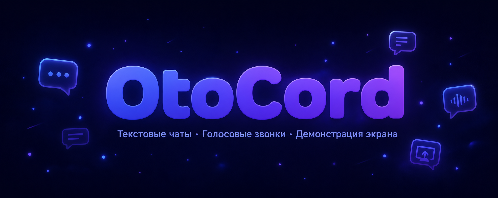

# OtoCord для Windows

**Всё в одном месте: текстовые чаты, голосовые звонки и демонстрация экрана**

### [⬇️ СКАЧАТЬ OTOCORD-SETUP.EXE](https://github.com/debilchik11/onicord-releases/releases/latest)

---

## 📥 Как установить

1. Нажмите кнопку **«Скачать»** выше — откроется страница последнего релиза.
2. Скачайте файл **`OtoCord-Setup.exe`** из блока **Assets**.
3. Запустите установку и следуйте подсказкам.
4. Откройте OtoCord, зарегистрируйтесь — и вы внутри.

> **Windows показывает «Система защитила ваш компьютер»?**
> Это нормально для приложений без цифровой подписи. Нажмите **«Подробнее» → «Выполнить в любом случае»**.

---

## ✨ Что умеет OtoCord

- 💬 **Серверы и личные сообщения** — каналы, роли, права, реакции, опросы, стикеры и эмодзи
- 🎙 **Голосовые звонки и демонстрация экрана** — с предпросмотром своей трансляции
- 🎮 **Игровая активность** — приложение само видит, во что вы играете, считает время и выдаёт значки за игровые часы и библиотеку игр
- 🎁 **Кейсы, подарки и экономика Кордс** — открывайте кейсы, дарите подписку и украшения друзьям
- ☁️ **Подписка OtoCord Cloud** — GIF-аватар и баннер, цвет и градиент имени, тема профиля и другие привилегии
- 🎨 **Персонализация** — украшения аватара, эффекты профиля, шрифты ника, темы оформления
- 🔔 **Уведомления и звуки** — включая отдельные паки звуков сообщения и звонка

---

## 🔄 Обновления

Приложение **обновляется само**: когда выходит новая версия, OtoCord скачает её в фоне и предложит перезапуститься. Вручную следить за релизами не нужно — но если хочется, все версии лежат [здесь](https://github.com/debilchik11/onicord-releases/releases).

---

## 💻 Системные требования

| | |
|---|---|
| **ОС** | Windows 10 или Windows 11 (64-bit) |
| **Место на диске** | ~350 МБ |
| **Интернет** | нужен для работы приложения |
| **Микрофон / камера** | только если пользуетесь звонками |

---

## 🌐 Нет Windows под рукой?

OtoCord работает прямо в браузере: **[otocord.vercel.app](https://otocord.vercel.app)** — тот же аккаунт, те же переписки.

---

Сделано с 💜 командой OtoCord · [Сайт](https://otocord.vercel.app) · [Все релизы](https://github.com/debilchik11/onicord-releases/releases)

